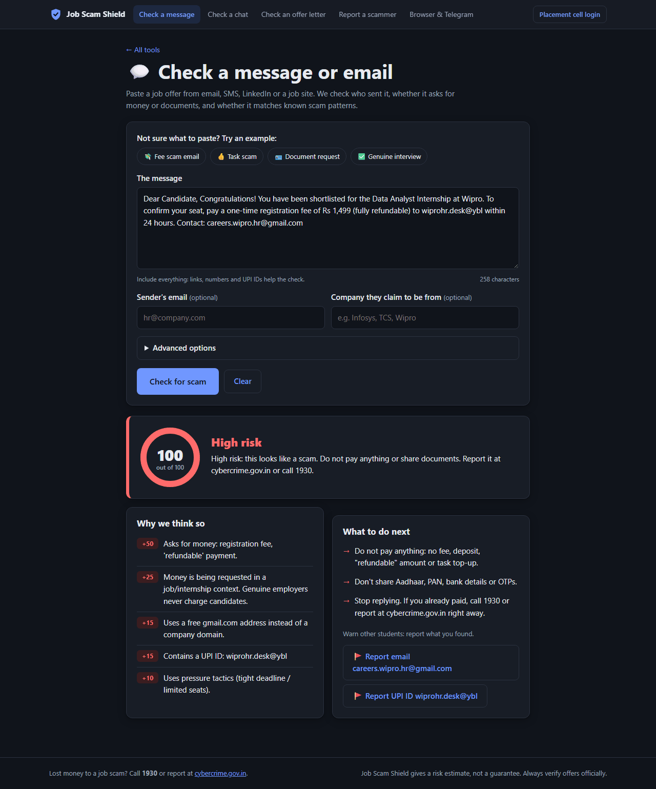
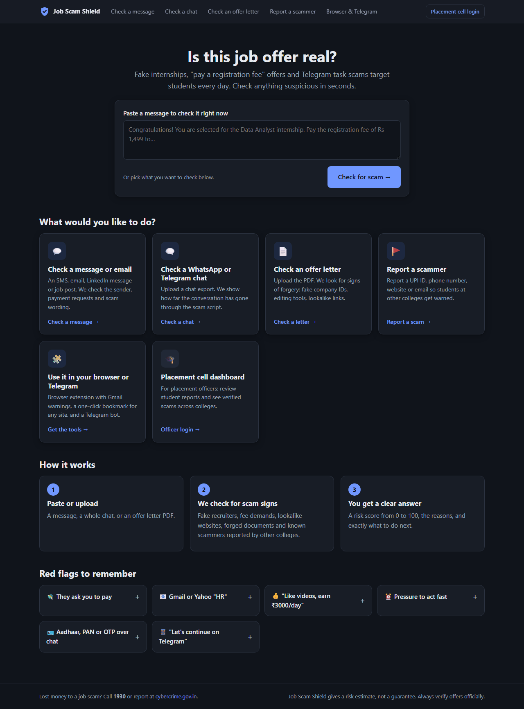
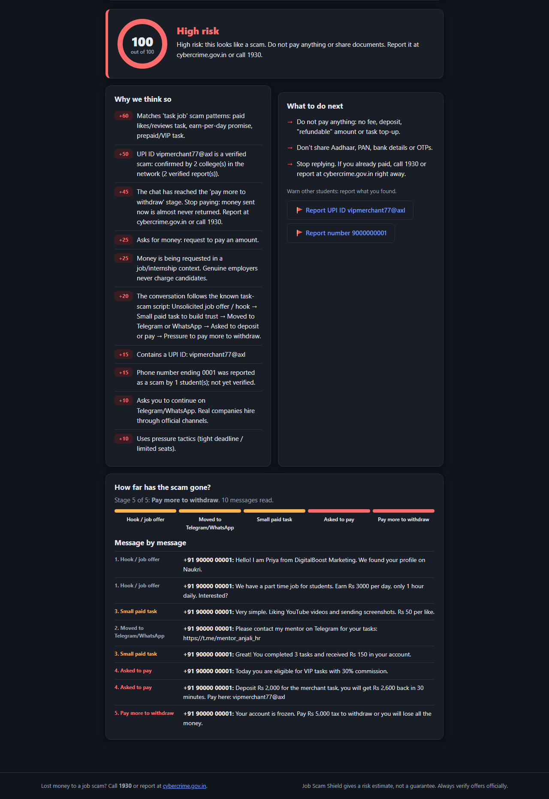
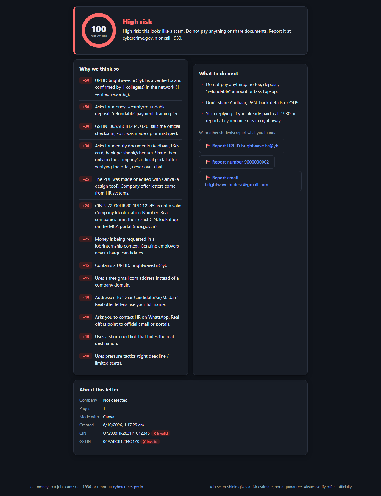
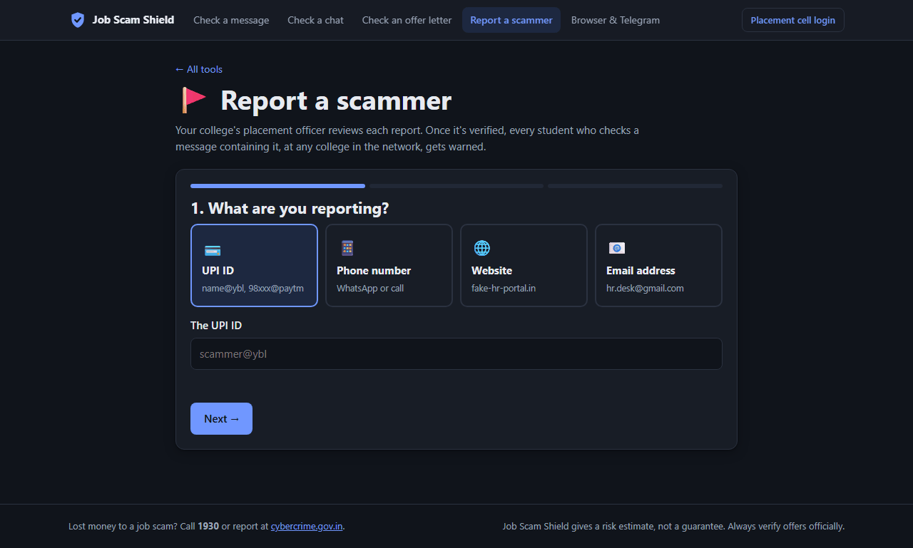
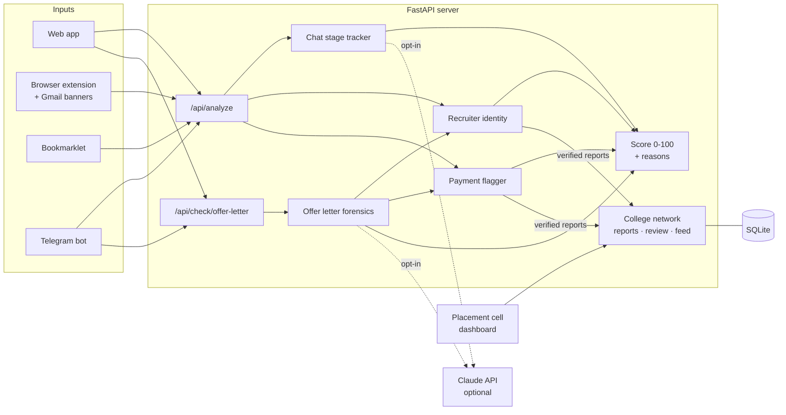

# 🛡️ Job Scam Shield

**Protects students from fake job and internship offers.**
Paste a message, upload a WhatsApp chat or an offer letter, or right-click any text in your
browser, and get a 0–100 risk score with plain-language reasons and what to do next.
Placement cells verify scam reports, and every college in the network gets warned.


[](https://github.com/akash9970singh/job-scam-shield/actions/workflows/tests.yml)


<p align="center">
  
</p>

## The problem

Students in India are prime targets for recruitment fraud:

- 💸 **"Pay a registration fee"** internships and "refundable" laptop deposits
- 👍 **Task scams** on Telegram: *"like YouTube videos, earn ₹3000/day"*, then *"deposit for VIP tasks"*
- 📄 **Forged offer letters** from lookalike domains such as `infosys-careers.co`
- 🪪 **Fake HR** asking for Aadhaar, PAN and OTPs over WhatsApp

Each message looks harmless on its own; the scam is in the pattern. And when one student gets
scammed, nobody at the next college finds out.

## What it does

| | Feature | What it catches |
|---|---|---|
| 💬 | **Message check** | Gmail "HR" claiming to be a company, lookalike and new domains, UPI IDs and payment links, fee and deposit wording (including Hinglish), document and OTP requests, pressure tactics |
| 🗨️ | **Chat stage tracker** | Reads a whole WhatsApp/Telegram conversation and shows how far it has gone through the scam script: *hook → move to Telegram → small paid task → deposit → "pay tax to withdraw"* |
| 📄 | **Offer letter forensics** | PDFs made in Canva or online editors, edits after creation, invalid CIN, GSTIN failing its checksum, lookalike links hidden in the PDF |
| 🚩 | **College threat-intel network** | Students report scammers; placement officers verify; verified UPI IDs, numbers and domains warn students at **every** college |
| 🧩 | **Everywhere students read offers** | Web app, browser extension with Gmail warnings (Chrome, Brave, Edge, Firefox), a bookmarklet for any browser, and a Telegram bot |
| 🤖 | **Optional AI mode** | Claude API labels unusual chat wording and reads scanned offer letters (opt-in) |

## Screenshots

<table>
  <tr>
    <td width="50%"><br><b>Home:</b> pick what to check</td>
    <td width="50%"><br><b>Chat check:</b> the scam reached stage 5 of 5</td>
  </tr>
  <tr>
    <td width="50%"><br><b>Offer letter:</b> fake CIN/GSTIN, made in Canva</td>
    <td width="50%"><br><b>Report a scammer:</b> 3 steps, live "already reported?" lookup</td>
  </tr>
</table>

## Quick start

Requires Python 3.11+.

```bash
git clone https://github.com/akash9970singh/job-scam-shield.git
cd job-scam-shield
python -m venv .venv
.venv\Scripts\activate          # macOS/Linux: source .venv/bin/activate
pip install -r requirements.txt
uvicorn app.main:app --reload
```

Open **http://127.0.0.1:8000**. To see it in action straight away:

- **http://127.0.0.1:8000/chat#example=1**: analyses an example Telegram task scam
- **http://127.0.0.1:8000/offer-letter#sample=fake_offer_brightwave.pdf**: checks a forged offer letter
- Run `python scripts/seed_demo.py`, then log in at `/dashboard` with a demo account from
  [`scripts/seed_demo.py`](scripts/seed_demo.py) to try the placement-cell dashboard
- **Telegram bot:** copy `.env.example` to `.env`, add your token from @BotFather, then run
  `python -m app.bot`. My instance is [@fakejobdetectorbot](https://t.me/fakejobdetectorbot)
  (it answers while my server is running)

The extension, Telegram bot, AI mode and admin tools are covered in the **[full guide](docs/GUIDE.md)**.

## How it works

Every check returns **signals**: points plus a reason a student can understand. The scorer adds
them up into a 0–100 score: **60+ high risk**, **30–59 suspicious**, otherwise low risk.



## Engineering highlights

- **Explainable by design.** Students see *why* something is risky, not just a number, plus concrete next steps and one-click reporting.
- **Tested on realistic cases.** 91 automated tests (run on every push by GitHub Actions), plus [sample scams and genuine messages](samples/test_messages.json) that guard against false alarms (*"TCS never asks for a fee"* must not count as a fee demand).
- **Abuse-resistant reporting.** Unverified reports count for little; only officer-verified reports carry weight, so one fake report can't brand a genuine recruiter.
- **Security basics done properly.** scrypt password hashing, hashed session tokens with expiry, rate limiting, college-scoped access, no public sign-up, CSV formula-injection guard.
- **Privacy first.** Messages are analysed in memory and never stored; report notes never leave the reporting college; AI mode is opt-in.
- **Real-world formats.** WhatsApp exports (Android and iPhone), Telegram forwards, PDFs with clickable links, GSTIN's mod-36 checksum, Indian CIN structure, Hinglish.

**Tech:** Python · FastAPI · Pydantic · SQLite · pypdf · dnspython · RDAP · rapidfuzz ·
Anthropic Claude API · vanilla JS · Manifest V3 extension · pytest · GitHub Actions

## Project structure

```
app/          FastAPI server: checks, scoring, college network, Telegram bot, web pages
extension/    Browser extension (Chrome, Brave, Edge, Opera, Firefox)
samples/      Sample scam and genuine messages, a WhatsApp export, demo offer letters
scripts/      Sample runner, demo data, screenshot and asset generators
tests/        pytest suite (runs offline)
docs/         Full guide and screenshots
```

## Limitations and roadmap

Rules catch the common scripts, not everything. Honest gaps (see [`samples/known_gaps.json`](samples/known_gaps.json)):

- [ ] Messages in Hindi script (Devanagari) and other regional languages
- [ ] Payment via gift cards or crypto (USDT), and "money mule" payment-agent jobs
- [ ] Fake cheque / overpayment scams and remote-access app requests (AnyDesk, APK files)
- [ ] Offer letters sent as photos (JPG/PNG), not PDF
- [ ] Hosted deployment with PostgreSQL, and publishing the extension to the browser stores

## Disclaimer

Job Scam Shield gives a risk estimate, not a guarantee. Always verify offers through the
company's official careers page. If you've lost money, call **1930** or report at
**[cybercrime.gov.in](https://cybercrime.gov.in)**.

## License

[MIT](LICENSE)
